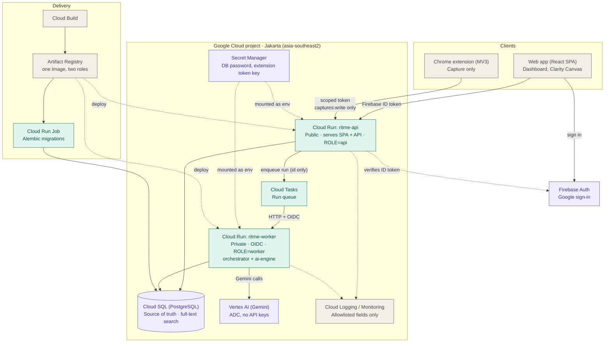

# Ritme — deployed architecture on Google Cloud

Editable Mermaid source. Paste the block into <https://mermaid.live> or any Markdown viewer that renders Mermaid
(GitHub, VS Code with a Mermaid extension).

## Notes

- **Two Cloud Run services from one image.** `ROLE=api` is public; `ROLE=worker` is private (only the Cloud Tasks service
  account may invoke it). The AI engine is a Python library inside the worker image, not a third service.
- **Service accounts (least privilege, no key files):**
  - `ritme-api`: `cloudsql.client`, `secretmanager.secretAccessor` (named secrets), `cloudtasks.enqueuer`,
    `aiplatform.user` (short steps such as draft clarification).
  - `ritme-worker`: `cloudsql.client`, `secretmanager.secretAccessor`, `aiplatform.user`.
  - Cloud Tasks invoker: `run.invoker` on `ritme-worker` only.
- **Vertex AI region** (`VERTEX_LOCATION`) may differ from the Jakarta region depending on model availability; the README
  must state where prompts are processed.
- **Cloud SQL** is reached through Cloud Run's built-in Cloud SQL connection (unix socket); no public authorized networks.
- **Cost control:** billing budget alert, `min-instances` configurable (set to 1 before a demo), Vertex quota awareness.
- Nothing here is provisioned yet; deployment steps will be listed in `docs/infrastructure.md`.
